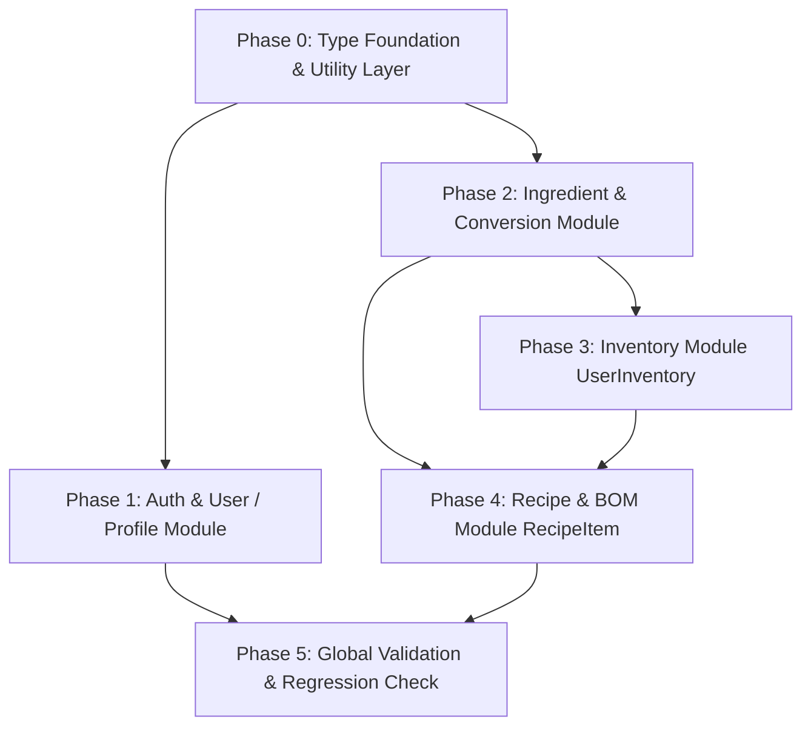

# Refactoring Plan: Schema Synchronization

## 1. Scope & Verification

### 1.1 Discovery Summary & Module Audit

An audit of the codebase (`src/routes/`, `src/controllers/`, `src/services/`, `src/validation/`, `src/types/dtos/`, and `src/docs/`) against the updated Prisma schema (`prisma/schema.prisma`) identified the following scope boundaries:

#### Verified Existing Modules (IN SCOPE for Refactoring):

1. **`auth`**: Handles user login, logout, and token refresh. Requires adjustment for nullable passwords (Google OAuth support) and relocation of user location to `BakerProfile`.
2. **`user` & `baker-profile`**: Handles user CRUD, saves, and profiles. Requires updates for PostGIS `location` moving from `"user"` to `"baker_profile"`, baker profile creation/updates, and soft-delete/cascade mechanics.
3. **`ingredient`**: Currently uses `String[]` for names. Requires refactoring to canonical `name` (String) + `slug` (String), `aliases` (`String[]`), `baseDimension` (`UnitDimension`), `baseUnit` (`StandardUnit`), autoincrement integer IDs, and support for `IngredientConversion`.
4. **`inventory` (`UserInventory`)**: Currently embedded in user routes (`/users/:id/inventories`) and recipe inspection. Requires removal of deprecated packaging fields (`packagePrice`, `packageSize`, `costUnit`, `measurementUnit`) and adoption of `costPerBaseUnit` (Decimal precision `12, 6`) with integer `ingredientId`.
5. **`recipe` & `RecipeItem` (Bill of Materials - BOM)**: Currently uses `RecipeIngredient` with string units. Requires transition to `RecipeItem` (`items` relation) supporting XOR between raw ingredients (`ingredientId: Int`) and sub-recipes (`subRecipeId: String`), metric `quantity` + `StandardUnit`, optional empirical `displayQuantity` + `displayUnit`, and updating recipe-level metrics (`profitMargin`, `overhead`, `hourlyLabor`, `packagingCost`).
6. **`tag`**: Tag management and querying. Requires type alignment and enum validation against `TagType`.

#### Excluded Unimplemented Modules (OUT OF SCOPE - Strict Boundary):

The following models exist in `prisma/schema.prisma` but have **NO** endpoints, routes, controllers, or services in `src/`. **Do NOT implement endpoints or services for these models**:

- **`Production`**: No production execution or history endpoints exist. Excluded from refactoring.
- **`InventoryTransaction` (Ledger / Livro-Razão)**: No inventory transaction ledger endpoints exist. Excluded from refactoring.
- **`RecipeReview`**: No recipe review or rating submission endpoints exist. Excluded from refactoring.
- **Standalone `baker-profile` routes**: Baker profiles remain managed under user profile workflows.
- **Standalone `inventory` routes**: Inventory operations remain under `/users/:id/inventories` and `/recipes/:id/users/:userId`.

### 1.2 Verification Baseline & Constraints

- **Language & Conventions**: Code, variables, functions, and types in English. OpenAPI tags, summaries, and descriptions strictly in Portuguese.
- **Typing**: Strict TypeScript (`noImplicitAny`). Avoid `any` except inside raw SQL `$queryRaw` calls.
- **Flow**: Unidirectional pipeline:
  $$\text{Zod Schemas} \longrightarrow \text{DTOs} \longrightarrow \text{Services} \longrightarrow \text{Controllers} \longrightarrow \text{Routes} \longrightarrow \text{OpenAPI Docs}$$
- **Migrations & Prisma Client**: Database migrations are handled manually by the user. Prisma Client is assumed to match `prisma/schema.prisma`.
- **Target Verification Baseline**:
  - Typecheck: `npx tsc --noEmit` passes with 0 errors.
  - Linting: `npx eslint <file>` (or `npx eslint src/`) passes with 0 errors.
  - Formatting: `npx prettier --write <file>` formats all modified files.

---

## 2. Execution Phases



---

### Phase 0: Type Foundation & Utility Layer

Audit shared types, enums, and utility functions needed by domain modules to avoid code duplication and typing gaps.

- [x] **Task 0.1: Implement Slug Generator Utility**
  - **Target File:** `src/utils/slugify.ts`
  - **Action:** Create a cohesive slug generator utility function `generateSlug(text: string): string` that:
    - Trims and lowercases the input string.
    - Normalizes diacritics/accents via `text.normalize('NFD').replace(/[\u0300-\u036f]/g, '')`.
    - Replaces special characters, spaces, and punctuation with hyphens (`-`).
    - Strips leading/trailing hyphens and collapses repeated hyphens.
  - **Definition of Done:**
    - `npx eslint src/utils/slugify.ts`
    - `npx prettier --write src/utils/slugify.ts`

- [x] **Task 0.2: Implement Standard Units and Dimension Helpers**
  - **Target File:** `src/utils/unit-conversion.ts`
  - **Action:** Create helper utilities and type mappings for `StandardUnit` and `UnitDimension`:
    - Define constant mappings between dimensions and units:
      - `MASS`: base `G` (multiplier 1), `KG` (multiplier 1000).
      - `VOLUME`: base `ML` (multiplier 1), `L` (multiplier 1000).
      - `COUNT`: base `UN` (multiplier 1).
    - Function `isUnitCompatibleWithDimension(unit: StandardUnit, dimension: UnitDimension): boolean`.
    - Function `convertToBaseUnit(quantity: number, unit: StandardUnit): number`.
  - **Definition of Done:**
    - `npx eslint src/utils/unit-conversion.ts`
    - `npx prettier --write src/utils/unit-conversion.ts`

- [x] **Task 0.3: Update Shared Error Codes and Context Interfaces**
  - **Target Files:**
    - `src/types/error.code.ts`
    - `src/types/context.interface.ts`
  - **Action:**
    - In `src/types/error.code.ts`, ensure error code union types cover schema mismatch scenarios:
      - Add `'INCOMPATIBLE_UNIT_DIMENSION'` to `ClientErrorCode`.
      - Add `'RECIPE_ITEM_INVALID_XOR'` to `ClientErrorCode`.
      - Add `'SUB_RECIPE_CIRCULAR_DEPENDENCY'` to `ResourceErrorCode`.
    - In `src/types/context.interface.ts`, type `userRole` as `Role` from Prisma client (`ADMIN | MODERATOR | BAKER | CUSTOMER`).
  - **Definition of Done:**
    - `npx tsc --noEmit`
    - `npx eslint src/types/error.code.ts src/types/context.interface.ts`
    - `npx prettier --write src/types/error.code.ts src/types/context.interface.ts`

---

### Phase 1: Authentication & User/Profile Module

Synchronize authentication and user profile logic with schema changes: nullable passwords (OAuth Google accounts) and moving `location` from the `User` table to `BakerProfile`.

- [x] **Task 1.1: Refactor Auth Service for Nullable Passwords and Profile Location**
  - **Target File:** `src/services/auth.service.ts`
  - **Action:**
    - In `logIn`:
      - Update raw SQL query: `location` column is no longer on `"user"`. Update query to `LEFT JOIN "baker_profile" bp ON bp.user_id = "user".id` and select `ST_AsGeoJSON(bp.location)::json as location`.
      - Check `foundUser.passwordHash`: if `null` (account registered via Google OAuth without password), throw `AuthError('Invalid credentials', 'AUTH_UNAUTHORIZED')` to prevent runtime error in `bcrypt.compare`.
      - Ensure `user.role` matches `Role` enum.
  - **Definition of Done:**
    - `npx eslint src/services/auth.service.ts`
    - `npx prettier --write src/services/auth.service.ts`

- [x] **Task 1.2: Update User Validation Schemas for BakerProfile**
  - **Target File:** `src/validation/user.schema.ts`
  - **Action:**
    - In `registerSchema`: Keep registration focused on credentials and core role (`role: z.enum(['BAKER', 'CUSTOMER'])`).
    - In `updateSchema`:
      - Add optional profile fields for bakers:
        - `bio: z.string().max(500).nullish()`.
        - `instagram: z.string().max(100).nullish()`.
        - `neighborhood: z.string().max(100).nullish()`.
        - `city: z.string().max(100).nullish()`.
      - Keep `location: locationSchema.nullish()`.
  - **Definition of Done:**
    - `npx eslint src/validation/user.schema.ts`
    - `npx prettier --write src/validation/user.schema.ts`

- [x] **Task 1.3: Update User DTOs for Profile Synchronization**
  - **Target File:** `src/types/dtos/user.dto.ts`
  - **Action:**
    - In `UserDTO.SelectResponse` and `UserDTO.UpdateResponse`:
      - Add optional `bio: string | null`, `instagram: string | null`, `neighborhood: string | null`, `city: string | null`.
      - Maintain `location: { latitude: number; longitude: number } | null`.
  - **Definition of Done:**
    - `npx eslint src/types/dtos/user.dto.ts`
    - `npx prettier --write src/types/dtos/user.dto.ts`

- [x] **Task 1.4: Refactor User Service for BakerProfile Separation and Cascade**
  - **Target File:** `src/services/user.service.ts`
  - **Action:**
    - In `register`:
      - If `data.role === 'BAKER'`, initialize a corresponding `bakerProfile` record inside `prisma.$transaction` (`tx.bakerProfile.create({ data: { userId: user.id } })`).
    - In `select`:
      - Update raw SQL query to `LEFT JOIN "baker_profile" bp ON bp.user_id = "user".id` selecting `bp.bio`, `bp.instagram`, `bp.neighborhood`, `bp.city`, and `ST_AsGeoJSON(bp.location)::json as location`.
      - Fix property access bug: parse location using `rawUser.location` (replacing invalid `rawUser.locationGeoJSON`).
    - In `update`:
      - Split payload between `"user"` table (`name`, `email`, `phone`, `pfpUrl`) and `"baker_profile"` table (`bio`, `instagram`, `neighborhood`, `city`, `location`).
      - If `location` or baker profile fields are present, execute upsert/update on `"baker_profile"` within the transaction:
        `UPDATE "baker_profile" SET location = ST_SetSRID(ST_MakePoint(${location.longitude}, ${location.latitude}), 4326), updated_at = NOW() WHERE user_id = ${id}`.
    - In `delete`:
      - On soft delete (`state === 'SUSPENDED'` or `'DELETED'`), anonymize credentials in `"user"`.
      - In `"baker_profile"`, clear location (`UPDATE "baker_profile" SET location = NULL WHERE user_id = ${id}`).
  - **Definition of Done:**
    - `npx eslint src/services/user.service.ts`
    - `npx prettier --write src/services/user.service.ts`

- [x] **Task 1.5: Update User and Auth OpenAPI Documentation**
  - **Target Files:**
    - `src/docs/components/user.component.yaml`
    - `src/docs/user.doc.yaml`
    - `src/docs/components/auth.component.yaml`
    - `src/docs/auth.doc.yaml`
  - **Action:**
    - Update `UserSelectResponse` and `AuthLogInResponse` schemas to include baker profile attributes (`bio`, `instagram`, `neighborhood`, `city`, `location`).
    - Document new update fields in `UserUpdateSchema`.
    - Ensure summaries, tags (`Usuários`, `Autenticação`), and response descriptions are in Portuguese.
  - **Definition of Done:**
    - `npx prettier --write src/docs/components/user.component.yaml src/docs/user.doc.yaml src/docs/components/auth.component.yaml src/docs/auth.doc.yaml`

---

### Phase 2: Ingredient & Unit Conversion Module

Refactor the Ingredient module from `name: String[]` to canonical `name: String` + `slug: String`, `aliases: String[]`, `baseDimension`, `baseUnit`, autoincrement integer IDs, and support for `IngredientConversion`.

- [x] **Task 2.1: Refactor Ingredient Zod Schemas**
  - **Target File:** `src/validation/ingredient.schema.ts`
  - **Action:**
    - In `registerSchema`:
      - `name`: `z.string().min(2, 'Name must have at least 2 characters').max(100)`.
      - `slug`: `z.string().trim().toLowerCase().regex(/^[a-z0-9-]+$/, 'Invalid slug format').optional()`.
      - `aliases`: `z.array(z.string().trim().min(1)).default([])`.
      - `category`: `z.string().min(2).max(50)`.
      - `description`: `z.string().nullable().optional()`.
      - `baseDimension`: `z.enum(['MASS', 'VOLUME', 'COUNT'])`.
      - `baseUnit`: `z.enum(['G', 'KG', 'ML', 'L', 'UN'])`.
      - Add `.refine()`: validate that `baseUnit` belongs to `baseDimension` (MASS $\to$ G/KG, VOLUME $\to$ ML/L, COUNT $\to$ UN).
      - `parentId`: `z.number().int().positive().nullable().optional()` (changed from `z.uuid()`).
      - `conversions`: `z.array(z.object({ fromUnit: z.string().trim().min(1).max(30), factorToBase: z.number().positive('Factor must be positive') })).optional()`.
    - Add `paramsSchema`:
      - `id`: `z.string().transform(Number).pipe(z.number().int().positive('Invalid ingredient ID'))`.
    - In `querySchema`:
      - Support pagination (`page`), search query (`search`), and optional filter by `category` and `baseDimension`.
  - **Definition of Done:**
    - `npx eslint src/validation/ingredient.schema.ts`
    - `npx prettier --write src/validation/ingredient.schema.ts`

- [x] **Task 2.2: Refactor Ingredient DTOs**
  - **Target File:** `src/types/dtos/ingredient.dto.ts`
  - **Action:**
    - In `IngredientDTO.RegisterRequest`: inferred from `ingredient.registerSchema`.
    - In `IngredientDTO.RegisterResponse`:
      - Update `ingredient`:
        - `id: number`
        - `parentId: number | null`
        - `name: string`
        - `slug: string`
        - `aliases: string[]`
        - `description: string | null`
        - `category: string`
        - `baseDimension: string`
        - `baseUnit: string`
        - `creatorId: string | null`
        - `createdAt: Date`
        - `conversions?: { id: number; fromUnit: string; factorToBase: Decimal }[]`
    - In `IngredientDTO.SearchResponse`:
      - Update array elements with `id: number`, `name: string`, `slug: string`, `aliases: string[]`, `baseDimension: string`, `baseUnit: string`, `category: string`, `description: string | null`.
    - In `IngredientDTO.RequestParam`: inferred from `ingredient.paramsSchema`.
  - **Definition of Done:**
    - `npx eslint src/types/dtos/ingredient.dto.ts`
    - `npx prettier --write src/types/dtos/ingredient.dto.ts`

- [x] **Task 2.3: Refactor Ingredient Service Business Logic**
  - **Target File:** `src/services/ingredient.service.ts`
  - **Action:**
    - In `register`:
      - Resolve `creatorId`: if user is `ADMIN`, allow `null` for global base ingredients; if `BAKER`, assign `context.userId`.
      - Generate canonical `slug`: use provided `data.slug` or generate via `generateSlug(data.name)`.
      - Check unique constraint `where: { creatorId_slug: { creatorId: creatorId ?? null, slug } }`. Throw `ConflictError('Ingredient with this slug already exists for this creator', 'RESOURCE_ALREADY_EXISTS')` on match.
      - If `data.parentId` is provided, verify parent exists (`prisma.ingredient.findUnique({ where: { id: data.parentId } })`).
      - Create ingredient with `data.conversions` nested create if present:
        ```typescript
        conversions: data.conversions?.length
          ? {
              create: data.conversions.map((conv) => ({
                fromUnit: conv.fromUnit,
                factorToBase: conv.factorToBase,
              })),
            }
          : undefined,
        ```
    - In `search`:
      - Build `baseFilter: Prisma.IngredientWhereInput`:
        - If `search`: filter with `OR: [{ name: { contains: search, mode: 'insensitive' } }, { slug: { contains: search, mode: 'insensitive' } }, { aliases: { has: search.toLowerCase() } }]`.
        - Accessibility: only show public base ingredients (`creatorId: null`) or ingredients created by the requester (`creatorId: context.userId`).
      - Return paginated results matching `SearchResponse`.
  - **Definition of Done:**
    - `npx eslint src/services/ingredient.service.ts`
    - `npx prettier --write src/services/ingredient.service.ts`

- [x] **Task 2.4: Update Ingredient Controller and Route**
  - **Target Files:**
    - `src/controllers/ingredient.controller.ts`
    - `src/routes/ingredient.route.ts`
  - **Action:**
    - In `ingredient.controller.ts`:
      - Fix method name typo: rename `serach` to `search`.
      - Replace `any` typings with strict `Request` and `Response` interfaces.
      - Pass `context` to `search` for user-scoped filtering.
    - In `ingredient.route.ts`:
      - Bind `ingredientController.search.bind(ingredientController)`.
  - **Definition of Done:**
    - `npx eslint src/controllers/ingredient.controller.ts src/routes/ingredient.route.ts`
    - `npx prettier --write src/controllers/ingredient.controller.ts src/routes/ingredient.route.ts`

- [x] **Task 2.5: Update Ingredient OpenAPI Documentation**
  - **Target Files:**
    - `src/docs/components/ingredient.component.yaml`
    - `src/docs/ingredient.doc.yaml`
  - **Action:**
    - Update `IngredientRegisterResponse` and `IngredientSearchResponse`:
      - Change `id` from UUID to `type: integer`.
      - Change `name` to `type: string`.
      - Add `slug` (`type: string`), `aliases` (`type: array`), `baseDimension` (enum: MASS, VOLUME, COUNT), `baseUnit` (enum: G, KG, ML, L, UN), and `conversions` array.
    - Verify Portuguese descriptions and tags (`Ingredientes`).
  - **Definition of Done:**
    - `npx prettier --write src/docs/components/ingredient.component.yaml src/docs/ingredient.doc.yaml`

---

### Phase 3: Inventory Module (`UserInventory`)

Refactor inventory logic to align with schema updates: remove obsolete packaging attributes (`packagePrice`, `packageSize`, `costUnit`, `measurementUnit`) and adopt `costPerBaseUnit` (Decimal precision `12, 6`) with integer `ingredientId`.

- [x] **Task 3.1: Refactor Inventory Validation Schemas**
  - **Target File:** `src/validation/user.schema.ts`
  - **Action:**
    - In `inventoryRegisterSchema`:
      - `ingredientId`: `z.number().int().positive('Ingredient ID must be a positive integer')` (was `z.string()`).
      - `currentQuantity`: `z.number().min(0, 'Current quantity cannot be negative').default(0)`.
      - `costPerBaseUnit`: `z.number().min(0, 'Cost per base unit cannot be negative').default(0)`.
      - Remove deprecated fields: `measurementUnit`, `packagePrice`, `packageSize`, `costUnit`.
  - **Definition of Done:**
    - `npx eslint src/validation/user.schema.ts`
    - `npx prettier --write src/validation/user.schema.ts`

- [x] **Task 3.2: Refactor Inventory DTOs**
  - **Target File:** `src/types/dtos/user.dto.ts`
  - **Action:**
    - In `RegisterUserInventoryRequest`: inferred from `user.inventoryRegisterSchema`.
    - In `RegisterUserInventoryResponse` and `SelectUserInventoryResponse`:
      - Replace `ingredientId: string` with `ingredientId: number`.
      - Replace packaging fields with `costPerBaseUnit: Decimal` and `currentQuantity: Decimal`.
      - Update nested `ingredient` object:
        - `id: number`
        - `name: string`
        - `slug: string`
        - `category: string`
        - `baseDimension: string`
        - `baseUnit: string`
        - `description: string | null`
  - **Definition of Done:**
    - `npx eslint src/types/dtos/user.dto.ts`
    - `npx prettier --write src/types/dtos/user.dto.ts`

- [x] **Task 3.3: Refactor Inventory Operations in User Service**
  - **Target File:** `src/services/user.service.ts`
  - **Action:**
    - In `registerUserInventory`:
      - Check ingredient existence: `prisma.ingredient.findUnique({ where: { id: data.ingredientId } })`. Throw `NotFoundError` if missing.
      - Check unique compound key: `prisma.userInventory.findUnique({ where: { userId_ingredientId: { userId: id, ingredientId: data.ingredientId } } })`. Throw `ConflictError` if already existing.
      - Create inventory record with `userId`, `ingredientId`, `currentQuantity`, `costPerBaseUnit`. Remove packaging calculation formulas.
      - Select and return updated inventory payload with canonical ingredient details.
    - In `selectUserInventory`:
      - Query `prisma.userInventory.findMany({ where: { userId: id } })`.
      - Select `ingredientId`, `currentQuantity`, `costPerBaseUnit`, `lastUpdated`, and joined `ingredient` (`id`, `name`, `slug`, `category`, `baseDimension`, `baseUnit`, `description`).
  - **Definition of Done:**
    - `npx eslint src/services/user.service.ts`
    - `npx prettier --write src/services/user.service.ts`

- [x] **Task 3.4: Update Inventory OpenAPI Documentation**
  - **Target Files:**
    - `src/docs/components/user.component.yaml`
    - `src/docs/user.doc.yaml`
  - **Action:**
    - In `UserInventoryRegisterSchema`, `UserInventoryRegisterResponse`, and `UserInventorySelectResponse`:
      - Remove `packagePrice`, `packageSize`, `costUnit`, and `measurementUnit`.
      - Add `costPerBaseUnit` (`type: number`, description: `Custo por unidade base do ingrediente`) and `currentQuantity` (`type: number`).
      - Set `ingredientId` to `type: integer`.
      - Update nested ingredient schema to reflect `name: string`, `slug: string`, `baseUnit: string`.
    - Ensure summaries and descriptions are in Portuguese.
  - **Definition of Done:**
    - `npx prettier --write src/docs/components/user.component.yaml src/docs/user.doc.yaml`

---

### Phase 4: Recipe & Bill of Materials (BOM) Module

Refactor the Recipe module to replace `RecipeIngredient` with `RecipeItem` (supporting BOM: raw ingredients vs sub-recipes via XOR), enforce `StandardUnit` on yield and items, and align user inventory inspection with `costPerBaseUnit`.

- [x] **Task 4.1: Refactor Recipe Zod Schemas for Bill of Materials (RecipeItem)**
  - **Target File:** `src/validation/recipe.schema.ts`
  - **Action:**
    - Replace `ingredientSchema` with `recipeItemSchema`:
      - `ingredientId`: `z.number().int().positive().nullable().optional()`.
      - `subRecipeId`: `z.uuid('Invalid UUID for sub-recipe ID').nullable().optional()`.
      - Add `.refine()` to enforce XOR logic:
        ```typescript
        .refine(
          (data) => (data.ingredientId != null) !== (data.subRecipeId != null),
          { message: 'Recipe item must specify either ingredientId or subRecipeId, but not both' }
        )
        ```
      - `quantity`: `z.number().positive('Quantity must be a positive number')`.
      - `unit`: `z.enum(['G', 'KG', 'ML', 'L', 'UN'])`.
      - `displayQuantity`: `z.number().positive().nullable().optional()`.
      - `displayUnit`: `z.string().max(30).nullable().optional()`.
      - `sortOrder`: `z.number().int().min(0).default(0)`.
      - `notes`: `z.string().max(255).nullable().optional()`.
    - In `registerSchema`:
      - `yieldUnit`: `z.enum(['G', 'KG', 'ML', 'L', 'UN'])` (`StandardUnit`).
      - `baseYield`: `z.number().positive('Base yield must be positive')`.
      - Replace `ingredients` array with `items: z.array(recipeItemSchema).min(1, 'Recipe must contain at least 1 item')`.
      - Add optional financial attributes: `profitMargin`, `overhead`, `hourlyLabor`, `packagingCost`.
  - **Definition of Done:**
    - `npx eslint src/validation/recipe.schema.ts`
    - `npx prettier --write src/validation/recipe.schema.ts`

- [x] **Task 4.2: Refactor Recipe DTOs**
  - **Target File:** `src/types/dtos/recipe.dto.ts`
  - **Action:**
    - In `RecipeDTO.RegisterRequest`: inferred from updated `recipe.registerSchema`.
    - In `RecipeDTO.RegisterResponse`:
      - Replace `ingredients` array with `items`:
        ```typescript
        items: {
          id: string;
          ingredientId: number | null;
          subRecipeId: string | null;
          quantity: Decimal;
          unit: string;
          displayQuantity: Decimal | null;
          displayUnit: string | null;
          sortOrder: number;
          notes: string | null;
        }
        [];
        ```
    - In `RecipeDTO.SingleSelectResponse`:
      - Update `items` array to include joined `ingredient` (`id: number`, `name: string`, `slug: string`, `category: string`, `baseUnit: string`, `baseDimension: string`) or `subRecipe` (`id: string`, `title: string`, `baseYield: Decimal`, `yieldUnit: string`).
    - In `RecipeDTO.SingleSelectUserInventoryResponse`:
      - Update `items` to include joined `ingredient` with `inventory: { currentQuantity: Decimal; costPerBaseUnit: Decimal; lastUpdated: Date } | null` or joined `subRecipe`.
  - **Definition of Done:**
    - `npx eslint src/types/dtos/recipe.dto.ts`
    - `npx prettier --write src/types/dtos/recipe.dto.ts`

- [x] **Task 4.3: Refactor Recipe Service Logic**
  - **Target File:** `src/services/recipe.service.ts`
  - **Action:**
    - In `register`:
      - Validate item references:
        - For each item with `ingredientId`: verify ingredient exists.
        - For each item with `subRecipeId`: verify sub-recipe exists, is accessible (published or owned by user), and guard against circular reference (`subRecipeId !== data.parentId`).
      - Save recipe using `prisma.recipe.create` with `items: { create: data.items.map(...) }` into `RecipeItem` (replacing obsolete `RecipeIngredient`).
    - In `selectSingle`:
      - Include `items`:
        ```typescript
        items: {
          orderBy: { sortOrder: 'asc' },
          include: {
            ingredient: {
              select: {
                id: true,
                name: true,
                slug: true,
                category: true,
                baseDimension: true,
                baseUnit: true,
              },
            },
            subRecipe: {
              select: {
                id: true,
                title: true,
                baseYield: true,
                yieldUnit: true,
              },
            },
          },
        },
        ```
    - In `selectSingleUserInventory`:
      - Include `items` with `ingredient` and nested `inventories` filtered by `userId`:
        ```typescript
        inventories: {
          where: { userId },
          select: {
            currentQuantity: true,
            costPerBaseUnit: true,
            lastUpdated: true,
          },
        },
        ```
      - Map results replacing deprecated packaging fields with `costPerBaseUnit` and `currentQuantity`.
  - **Definition of Done:**
    - `npx eslint src/services/recipe.service.ts`
    - `npx prettier --write src/services/recipe.service.ts`

- [x] **Task 4.4: Update Recipe Controller and Route**
  - **Target Files:**
    - `src/controllers/recipe.controller.ts`
    - `src/routes/recipe.route.ts`
  - **Action:**
    - Remove all `any` typings from `RecipeController`.
    - Strongly type requests and responses using `RecipeDTO`.
    - Ensure routes in `recipe.route.ts` pass typed validation middleware.
  - **Definition of Done:**
    - `npx eslint src/controllers/recipe.controller.ts src/routes/recipe.route.ts`
    - `npx prettier --write src/controllers/recipe.controller.ts src/routes/recipe.route.ts`

- [x] **Task 4.5: Update Recipe OpenAPI Documentation**
  - **Target Files:**
    - `src/docs/components/recipe.component.yaml`
    - `src/docs/recipe.doc.yaml`
  - **Action:**
    - In `recipe.component.yaml`:
      - Replace `RecipeIngredient` with `RecipeItem` schema definition:
        - `ingredientId` (`type: integer`, `nullable: true`).
        - `subRecipeId` (`type: string`, `format: uuid`, `nullable: true`).
        - `quantity` (`type: number`).
        - `unit` (`type: string`, `enum: [G, KG, ML, L, UN]`).
        - `displayQuantity` (`type: number`, `nullable: true`).
        - `displayUnit` (`type: string`, `nullable: true`).
        - `sortOrder` (`type: integer`).
        - `notes` (`type: string`, `nullable: true`).
      - Update `yieldUnit` to enum `[G, KG, ML, L, UN]`.
      - In `RecipeSingleSelectUserInventoryResponse`, update inventory schema to `costPerBaseUnit` and `currentQuantity`.
    - In `recipe.doc.yaml`:
      - Update endpoint paths, parameters, and Portuguese descriptions.
  - **Definition of Done:**
    - `npx prettier --write src/docs/components/recipe.component.yaml src/docs/recipe.doc.yaml`

---

### Phase 5: Global Validation & Regression Check

Ensure end-to-end type safety, code cleanliness, and documentation integrity across the entire project.

- [x] **Task 5.1: Execute Full Project TypeScript Compilation**
  - **Command:** `npx tsc --noEmit`
  - **Criteria:** 0 compilation errors across all modules (`src/`).

- [x] **Task 5.2: Execute Full Project ESLint Verification**
  - **Command:** `npx eslint src/`
  - **Criteria:** 0 lint warnings or errors, 0 illegal `any` usages outside Raw SQL.

- [x] **Task 5.3: Execute Full Project Prettier Formatting**
  - **Command:** `npx prettier --write src/`
  - **Criteria:** All files conform to repository Prettier standards.

- [x] **Task 5.4: Verify Swagger Documentation Assembly**
  - **Command:** `npx tsx -e "import app from './src/app'; console.log('Swagger and routes booted successfully');"`
  - **Criteria:** Swagger JSDoc successfully parses all YAML documents and Zod schemas without missing component references or runtime errors.
